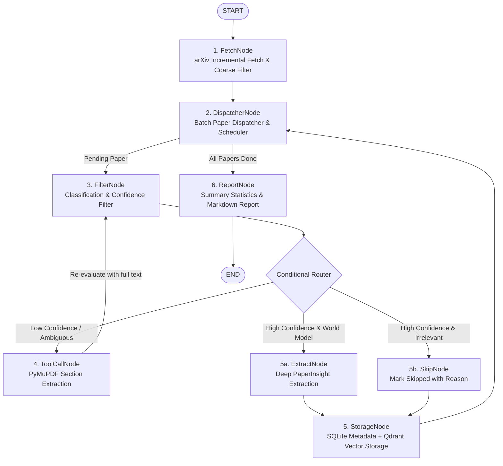
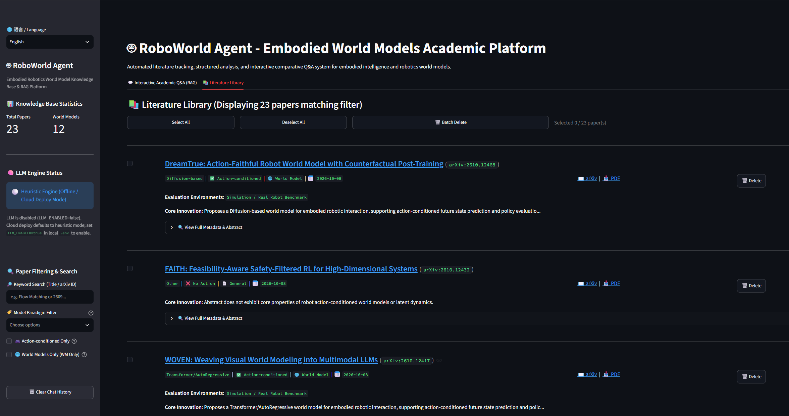

# 🤖 RoboWorld-Agent: Robotics World Model Literature Tracking & Intelligent Analysis System

[](https://www.python.org/downloads/)
[](https://docs.astral.sh/uv/)
[]()
[](https://github.com/astral-sh/ruff)
[](https://mypy-lang.org/)

[English](README.md) | [中文说明](README-ZH.md)

**RoboWorld-Agent** is an automated system tailored for **Embodied AI** and **Robotics World Models**, featuring paper tracking, structured analysis, knowledge base storage, interactive comparative RAG Q&A, and full-pipeline observability & evaluation.

The system performs daily incremental fetches of cutting-edge arXiv papers, conducts domain ontology-based classification (distinguishing action-conditioned world models from general text-to-video generation), extracts key methodology sections via targeted PDF parsing when necessary, and persists paper metadata and chunk embeddings to SQLite and Qdrant respectively. In addition, it supports rendering elegant Markdown daily reports to communication chats and provides an interactive Streamlit Web UI for multi-dimensional filtering, exploration, and comparative RAG Q&A.

---

## Table of Contents

- [I. Features](#i-features)
- [II. Architecture & State Topology](#ii-architecture--state-topology)
- [III. Prerequisites & Quick Start](#iii-prerequisites--quick-start)
  - [1. Environment Setup](#1-environment-setup)
  - [2. Environment Variables (.env)](#2-environment-variables-env)
  - [3. Create data Directory](#3-create-data-directory)
- [IV. Usage Guide](#iv-usage-guide)
  - [1. Daily Pipeline & Scheduled Morning Briefings (Workflow & Scheduler)](#1-daily-pipeline--scheduled-morning-briefings-workflow--scheduler)
  - [2. Interactive Streamlit Web Interface (Web UI)](#2-interactive-streamlit-web-interface-web-ui)
  - [3. Hybrid Storage Engine API (Storage Layer)](#3-hybrid-storage-engine-api-storage-layer)
- [V. Repository Structure](#v-repository-structure)
- [License](#license)

---

## I. Features

1. **Automated Fetching & Robust Coarse Filtering**:
   - Covers core subfields including `cs.RO` (Robotics), `cs.AI` (Artificial Intelligence), and `cs.LG` (Machine Learning);
   - Features exponential backoff retry mechanisms and regex keyword-based title/abstract pre-filtering to filter out irrelevant noise.
2. **Decision Boundaries for Robotics World Models**:
   - Strictly distinguishes embodied world models featuring closed-loop dynamics transitions $p(s_{t+1}|s_t, a_t)$ from general text-to-video generative models without action conditioning;
   - Extracts structured `PaperInsight`, including model paradigm (Flow-Matching / Diffusion-based / Transformer, etc.), action conditioning status, evaluation benchmark environments (CALVIN / RLBench, etc.), and core innovations.
3. **Targeted PDF Key Section Extraction (Tool Use)**:
   - Powered by PyMuPDF for high-speed text stream extraction and regex-based header segmentation;
   - When abstract confidence is low, targetedly retrieves `Methodology` / `Experiments` sections within 3 seconds, automatically filtering out formulas and references.
4. **Hybrid Dual-Engine Storage (SQLite + Qdrant)**:
   - SQLite manages full metadata and analysis status with idempotency and deduplication guarantees;
   - Embedded local Qdrant vector database stores multi-dimensional payload chunks for cosine similarity nearest-neighbor semantic retrieval.
5. **LangGraph Main State Machine Orchestration**:
   - Isolated state branching: single paper processing failures do not affect the overall pipeline;
   - Conditional routing adapts workflow execution based on confidence levels (skip, deep extraction, or closed-loop tool invocation).
6. **Automated Daily Reports & Scheduled Push**:
   - Jinja2 renders well-structured Markdown digests, supporting LLM and heuristic paper summaries. Summaries are also displayed in the Streamlit interface;
   - Supports long-running APScheduler daemons and native Linux Crontab command generation.
7. **Interactive Streamlit Web UI**:
   - Sidebar filtering supporting paradigm, action conditioning, date range, and keyword fuzzy search;
   - Integrated vector RAG academic dialogue interface with cross-paper comparative tables and standard literature citation sourcing.
8. **End-to-End Observability & Automated Evaluation**:
   - Mounts LangSmith / Phoenix to trace all LLM invocation topologies;
   - `TokenUsageTracker` monitors prompt tokens and latency;

---

## II. Architecture & State Topology

The core system is orchestrated by a **LangGraph** state machine. The complete execution topology is shown below:



---

## III. Prerequisites & Quick Start

### 1. Environment Setup

- **Operating System**: Linux / WSL2 (Ubuntu 22.04+)
- **Python Version**: `>= 3.11`
- **Package Manager**: [uv](https://docs.astral.sh/uv/) (strongly recommended)

Install `uv` (if not already installed):
```bash
curl -LsSf https://astral.sh/uv/install.sh | sh
```

Create virtual environment and install locked dependencies in project root:
```bash
# Install all dependencies from uv.lock (including dev group)
uv sync --frozen

# Install git pre-commit hooks for static checks
uv run pre-commit install
```

### 2. Environment Variables (.env)

Create `.env` from template:
```bash
cp .env.example .env
```

Configuration items supported in `.env`:

```ini
# ============================================================================
# 1. LLM API Configuration
# ============================================================================
LLM_ENABLED=false
LLM_PROVIDER=openai
LLM_API_KEY=your_openai_api_key_here
LLM_BASE_URL=https://api.openai.com/v1
LLM_MODEL=gpt-4o-mini

# ============================================================================
# 2. Observability & Tracing (LangSmith / Phoenix)
# ============================================================================
LANGCHAIN_TRACING_V2=true
LANGCHAIN_API_KEY=your_langsmith_api_key_here
LANGCHAIN_PROJECT=roboworld-agent

# ============================================================================
# 3. Local Storage Paths
# ============================================================================
SQLITE_DB_PATH=data/papers.db
QDRANT_STORAGE_PATH=data/qdrant_storage

# ============================================================================
# 4. Scheduling & Notification Push
# ============================================================================
SCHEDULE_HOUR=8
SCHEDULE_MINUTE=0
# CRON_SCHEDULE=0 8 * * *
```

### 3. Create data Directory
```bash
mkdir data
# Used to store database and reports
```

---

## IV. Usage Guide

### 1. Daily Pipeline & Scheduled Morning Briefings (Workflow & Scheduler)

`src/workflows/scheduler.py` integrates the LangGraph workflow, `MarkdownReporter`, and APScheduler.

Paper collection queries category filter `(cat:cs.RO OR cat:cs.AI OR cat:cs.LG)` ordered by last updated date descending. Dates are **not** written into arXiv `search_query` directly (the arXiv API does not support `lastUpdatedDate` filter syntax). Truncation supports three modes:

1. **Days-only `--days-back N`**: Retains papers where `updated` is in `[now - N days, now]` (UTC, including revised editions), paginating until leaving the time window, **without paper count cutoff**.
2. **Results-only `--max-results N`**: Retrieves the N most recently updated papers, with no date restrictions.
3. **Combined**: Requires papers to fall into the time window first, keeping at most N papers.

When both parameters are omitted, the pipeline defaults to **all papers in the past 1 day** (equivalent to `--days-back 1`). Because the daily arXiv update has a delay, `--days-back 1` might result in missing new papers; therefore, at least `--days-back 2/3` is recommended.

When encountering HTTP 429 rate limits, it applies exponential backoff starting from 60 seconds up to 5 minutes before retrying.

#### Command-Line Interface (Run under the root directory roboworld-agent)

Run once, full fetch for the past 3 days (recommended daily use):

```bash
uv run python -m src.workflows.scheduler --run-now --days-back 3
```

Run once, fetch the 50 most recently updated papers:

```bash
uv run python -m src.workflows.scheduler --run-now --max-results 50
```

Run once, up to 50 papers within the past 3 days:

```bash
uv run python -m src.workflows.scheduler --run-now --days-back 3 --max-results 50
```

Scheduled run (daemon process (e.g. via tmux), triggered daily at `SCHEDULE_HOUR` / `SCHEDULE_MINUTE` defined in `.env`, or specified via command line). You can similarly specify days only, count only, or both:

```bash
# Daily full fetch for the past 3 days
uv run python -m src.workflows.scheduler --daemon --days-back 3

# Daily at 10:00, up to 50 papers in the past 3 days
uv run python -m src.workflows.scheduler --daemon --cron "0 10 * * *" --days-back 3 --max-results 50
```

Generate a ready-to-use cron command for `crontab -e`:

```bash
uv run python -m src.workflows.scheduler --generate-crontab --cron "0 10 * * *"
```

Common Parameters:

| Argument | Default | Description |
| --- | --- | --- |
| `--days-back` | Treated as `1` if `--max-results` is also omitted | Date truncation: only keeps papers updated in the past N days; fetches all matching papers when used alone |
| `--max-results` | None (no limit) | Count truncation: keeps at most N papers (ordered by latest update descending) |
| `--output-dir` | `data/reports` | Directory where Markdown digest reports are saved |

#### Python API Usage
```python
from src.workflows.scheduler import run_daily_pipeline

# Full fetch for the past 1 day
result = run_daily_pipeline(days_back=1, output_dir="data/reports")
print(f"Report generated at: {result['report_path']}")
print(
    f"Processed papers: {result['processed_count']}, Token usage: {result['token_usage']}"
)
```

#### Summary Report Generation
When the LLM API in `.env` is correctly configured, LLM will be used to generate a summary for each paper. If misconfigured, it falls back to heuristic determination, with rules defined in `agents/classifier_agent.py`.

---

### 2. Interactive Streamlit Web Interface (Web UI)

`src/app.py` provides an interactive Web UI for literature repository browsing, multi-dimensional filtering, and comparative RAG Q&A.



#### Launch Web UI (from root directory roboworld-agent)
```bash
uv run streamlit run src/app.py
```
After starting, open your browser and navigate to the address shown.

#### Key UI Features
- **Tab 1: 💬 Interactive Academic Q&A (RAG)**:
  - Supports cross-paper comparative inquiries (e.g., *"Compare robotics world models using Flow Matching vs. Diffusion architectures"*);
  - Outputs structured comparative matrices and technical trade-off analyses;
  - Allows LLM integration for conversations. However, the current truncation limit is 5. In `src/app.py`: `search_results = synthesizer.search(query=active_prompt, limit=5)`.
- **Tab 2: 📚 Paper Repository**:
  - Card-based browsing of indexed papers with badges for paradigms, evaluation benchmarks, core innovations, and full metadata.

---

### 3. Hybrid Storage Engine API (Storage Layer)

`src/storage/` provides dual-database management:
- `DBManager`: SQLite CRUD operations, persistence, and deduplication.
- `VectorStore`: Qdrant embedded vector index and semantic nearest-neighbor search.

```python
from src.storage import DBManager, VectorStore

# 1. Query papers in SQLite
db = DBManager()
papers = db.list_papers(is_wm=True, limit=10)
print(f"Indexed world model papers: {len(papers)}")

# 2. Qdrant semantic nearest-neighbor search
vs = VectorStore()
search_results = vs.search(
    query="Flow Matching robotic world models",
    limit=3,
    filter_criteria={"model_paradigm": "Flow-Matching"},
)
for res in search_results:
    print(f"[{res.arxiv_id}] {res.title} (Score: {res.score:.3f})")
```

---

## V. Repository Structure

```text
roboworld-agent/
├── data/
│   ├── papers.db               # Local SQLite metadata database
│   └── qdrant_storage/         # Local Qdrant vector index data directory
├── src/
│   ├── __init__.py
│   ├── app.py                  # Streamlit interactive Q&A and knowledge base frontend
│   ├── agents/
│   │   ├── __init__.py
│   │   └── classifier_agent.py # Classification and insight extraction agent (Heuristic + LLM)
│   ├── core/
│   │   ├── __init__.py
│   │   └── schema.py           # Core domain models (RawPaper, PaperInsight)
│   ├── evaluation/             # Task 5.3: Observability and evaluation module
│   │   ├── __init__.py
│   │   ├── dataset.py          # Golden dataset loading and validation
│   │   ├── eval_runner.py      # CLI automated evaluation entrypoint
│   │   ├── evaluator.py        # Evaluation engine, confusion matrix, and reporting
│   │   └── tracing.py          # TokenUsageTracker and LangSmith tracing manager
│   ├── fetchers/
│   │   ├── __init__.py
│   │   └── arxiv_fetcher.py    # arXiv crawler with exponential backoff & filtering
│   ├── storage/
│   │   ├── __init__.py
│   │   ├── db_manager.py       # SQLite persistence and deduplication
│   │   └── vector_store.py     # Qdrant chunk embedding and retrieval engine
│   ├── tools/
│   │   ├── __init__.py
│   │   ├── pdf_parser.py       # PyMuPDF targeted section extraction tool
│   │   └── reporter.py         # Jinja2 Markdown digest renderer and webhook dispatcher
│   └── workflows/
│       ├── __init__.py
│       ├── graph.py            # LangGraph main state graph and conditional orchestration
│       └── scheduler.py        # APScheduler cron daemon and daily morning pipeline
├── tests/                      # Comprehensive automated test suite (92 passed)
│   ├── test_app.py             # Streamlit UI and RAG comparative Q&A tests
│   ├── test_arxiv_fetcher.py   # arXiv collection and retry tests
│   ├── test_evaluation.py      # Observability, token counting, and Golden Dataset tests
│   ├── test_pdf_parser.py      # PDF parsing and formula cleaning tests
│   ├── test_scheduler_reporter.py # Digest rendering and scheduling tests
│   ├── test_schema.py          # Pydantic domain model tests
│   ├── test_storage.py         # SQLite and Qdrant storage tests
│   └── test_workflow_graph.py  # LangGraph state machine topology tests
├── pyproject.toml              # Project configuration and dependency constraints
├── uv.lock                     # Dependency lockfile
├── README.md                   # English project documentation
└── README-ZH.md                # Chinese project documentation
```

---

## License

This project is licensed under the MIT License.
