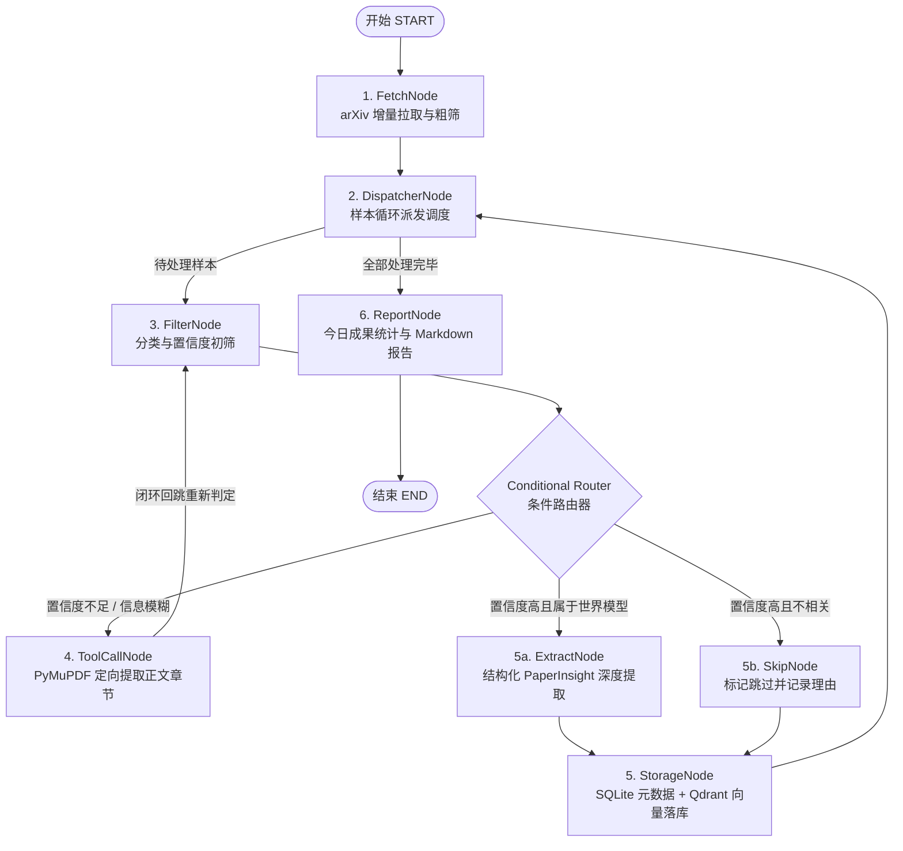

# 🤖 RoboWorld-Agent: 具身机器人世界模型文献追踪与智能研判系统

[](https://www.python.org/downloads/)
[](https://docs.astral.sh/uv/)
[]()
[](https://github.com/astral-sh/ruff)
[](https://mypy-lang.org/)

**RoboWorld-Agent** 是面向具身智能（Embodied AI）与机器人世界模型（Robotics World Models）领域打造的自动化文献追踪、结构化研判、知识库存储、交互式横向对比问答与全流程可观测性评估系统。

系统能够每日定时增量抓取 arXiv 前沿文献，通过严密的领域本体研判（严格区分动作闭环世界模型与通用非具身视频生成），在必要时定向调阅 PDF 核心方法章节，并将元数据与切片向量分别持久化至 SQLite 与 Qdrant。同时，系统支持生成优雅的 Markdown 晨报推送至通信群聊，并提供基于 Streamlit 的可视化多维检索与 RAG 问答界面。

---

## 目录

- [一、核心功能亮点](#一核心功能亮点)
- [二、系统架构与状态拓扑](#二系统架构与状态拓扑)
- [三、环境要求与快速配置](#三环境要求与快速配置)
  - [1. 基础环境安装](#1-基础环境安装)
  - [2. 环境变量配置 (.env)](#2-环境变量配置-env)
- [四、各模块内容与使用方法](#四各模块内容与使用方法)
  - [1. 每日定时流水线与自动化早报 (Workflow & Scheduler)](#1-每日定时流水线与自动化早报-workflow--scheduler)
  - [2. Streamlit 交互式问答与文献库界面 (Web UI)](#2-streamlit-交互式问答与文献库界面-web-ui)
  - [3. 自动化 Eval 评测与质量门禁 (Evaluation & Tracing)](#3-自动化-eval-评测与质量门禁-evaluation--tracing)
  - [4. PDF 定向章节解析工具 (PDF Tool)](#4-pdf-定向章节解析工具-pdf-tool)
  - [5. 元数据与向量存储底层 API (Storage Layer)](#5-元数据与向量存储底层-api-storage-layer)
- [五、代码仓库目录结构](#五代码仓库目录结构)
- [六、开发与质量检验](#六开发与质量检验)

---

## 一、核心功能亮点

1. **自动化采集与鲁棒粗筛**：
   - 覆盖 `cs.RO`（机器人学）、`cs.AI`（人工智能）、`cs.LG`（机器学习）等核心子领域；
   - 具备指数退避重试（Exponential Backoff）与针对 Title/Abstract 的正则关键词初筛，过滤明显无关噪音。
2. **严密的机器人世界模型研判边界**：
   - 严格区分具备动作闭环动力学转移 $p(s_{t+1}|s_t, a_t)$ 的具身世界模型与无动作输入的通用文生视频模型；
   - 提取结构化 `PaperInsight`，包含模型范式（Flow-Matching / Diffusion-based / Transformer 等）、是否 Action-conditioned、评测基准环境（CALVIN / RLBench 等）及核心创新点。
3. **定向 PDF 核心章节提取 (Tool Use)**：
   - 基于 PyMuPDF 实现纯文本流提取与快速正则标题切分；
   - 在摘要置信度不足时，3秒内定向调阅 `Methodology` / `Experiments` 段落，自动清洗公式与参考文献。
4. **双底座混合存储 (SQLite + Qdrant)**：
   - SQLite 记录全文元数据与研判状态，具备写入幂等与去重保障；
   - 本地内嵌 Qdrant 向量库存储多维 Payload 切片，提供余弦相似度近邻语义检索。
5. **LangGraph 主状态机编排**：
   - 状态分支隔离：单篇样本失败不影响整体流水线；
   - 条件路由根据置信度自适应流转至跳过、深度提取或工具调用闭环。
6. **自动化晨报与定时推送**：
   - Jinja2 渲染结构优美的 Markdown 简报，支持落盘并一键推送飞书/钉钉/企业微信/Slack Webhook；
   - 支持 APScheduler 常驻调度与原生 Linux Crontab 指令生成。
7. **Streamlit 交互式 Web 前端**：
   - 文献库侧边栏支持按范式、Action-conditioned、时间、关键词多维标签实时筛选；
   - 挂载向量检索的 RAG 学术问答对话框，支持多篇文献横向对比表格生成与原始文献规范溯源。
8. **全流程可观测性与 Eval 评测**：
   - 无缝挂载 LangSmith / Phoenix 记录所有 LLM 调用拓扑；
   - `TokenUsageTracker` 监控 Prompt Tokens 与耗时；
   - 提供 20 篇代表性黄金数据集（10 篇标准世界模型 + 10 篇边缘混淆），支持 CI/CD 自动化 Precision/Recall 门禁检验。

---

## 二、系统架构与状态拓扑

系统核心基于 **LangGraph** 状态机构建，完整执行拓扑如下：



---

## 三、环境要求与快速配置

### 1. 基础环境安装

- **操作系统**：Linux / macOS / WSL2 (Ubuntu 22.04+)
- **Python 版本**：`>= 3.11`
- **包管理器**：推荐使用极速包管理器 [uv](https://docs.astral.sh/uv/)

安装 `uv`（若未安装）：
```bash
curl -LsSf https://astral.sh/uv/install.sh | sh
```

在项目根目录下完成虚拟环境创建与依赖锁定安装：
```bash
# 从锁定文件 uv.lock 一键安装所有依赖（包含 dev 分组）
uv sync --frozen

# 安装 git pre-commit 静态检查钩子
uv run pre-commit install
```

### 2. 环境变量配置 (.env)

从模板创建 `.env` 配置文件：
```bash
cp .env.example .env
```

`.env` 文件支持的配置项如下：

```ini
# ============================================================================
# 1. LLM API 配置 (可选，未配置时自动使用内置高质量启发式规则引擎)
# ============================================================================
OPENAI_API_KEY=your_openai_api_key_here
OPENAI_BASE_URL=https://api.openai.com/v1

# ============================================================================
# 2. 可观测性追踪 (LangSmith / Phoenix)
# ============================================================================
LANGCHAIN_TRACING_V2=true
LANGCHAIN_API_KEY=your_langsmith_api_key_here
LANGCHAIN_PROJECT=roboworld-agent

# ============================================================================
# 3. 本地存储底座路径
# ============================================================================
SQLITE_DB_PATH=data/papers.db
QDRANT_STORAGE_PATH=data/qdrant_storage

# ============================================================================
# 4. 定时调度与通知推送
# ============================================================================
SCHEDULE_HOUR=8
SCHEDULE_MINUTE=0
# CRON_SCHEDULE=0 8 * * *
WEBHOOK_URL=https://open.feishu.cn/open-apis/bot/v2/hook/your-token-here
```

---

## 四、各模块内容与使用方法

### 1. 每日定时流水线与自动化早报 (Workflow & Scheduler)

`src/workflows/scheduler.py` 整合了 LangGraph 图、MarkdownReporter 与 APScheduler 调度器。

采集只按分类查询 `(cat:cs.RO OR cat:cs.AI OR cat:cs.LG)`，按最近更新时间降序翻页；日期**不写进** arXiv `search_query`（官方不支持 `lastUpdatedDate` 过滤字段）。截断有三种用法，省略的条件不生效：

1. **只按天数 `--days-back N`**：按 `updated` 保留 `[now - N 天, now]`（UTC，含修订稿），一直翻页到走出窗口为止，**不先按篇数截断**。
2. **只按篇数 `--max-results N`**：取最近更新的 N 篇，不做日期过滤。
3. **两个都给**：先落入时间窗，再最多保留 N 篇。

两个参数都省略时，默认按 **1 天拉全量**（等价于只写 `--days-back 1`）。遇到 HTTP 429 时从 60 秒起指数退避，最长等 5 分钟再重试。

#### 命令行运行 (CLI)

单次总结，只按最近 1 天拉全量（推荐日常用法）：

```bash
uv run python -m src.workflows.scheduler --run-now --days-back 1
```

单次总结，只取最近更新的 50 篇：

```bash
uv run python -m src.workflows.scheduler --run-now --max-results 50
```

单次总结，最近 1 天内最多 50 篇：

```bash
uv run python -m src.workflows.scheduler --run-now --days-back 1 --max-results 50
```

定时总结（常驻守护，每天按 `.env` 的 `SCHEDULE_HOUR` / `SCHEDULE_MINUTE` 触发）。同样可以只按天、只按篇数，或两者同时给：

```bash
# 每天拉最近 1 天全量
uv run python -m src.workflows.scheduler --daemon --days-back 1

# 指定每天 10:00，最近 1 天内最多 50 篇
uv run python -m src.workflows.scheduler --daemon --cron "0 10 * * *" --days-back 1 --max-results 50
```

生成可写入 `crontab -e` 的系统定时命令：

```bash
uv run python -m src.workflows.scheduler --generate-crontab --cron "0 10 * * *"
```

常用参数：

| 参数 | 默认值 | 作用 |
| --- | --- | --- |
| `--days-back` | 省略时若也未给 `--max-results` 则视为 `1` | 天数截断：只保留最近 N 天有更新的论文；单独使用时拉满该窗口 |
| `--max-results` | 省略则不截篇数 | 篇数截断：最多保留 N 篇（按最近更新降序） |
| `--output-dir` | `data/reports` | 简报 Markdown 落盘目录 |
| `--webhook-url` | 无 | 可选，推送到飞书 / 钉钉 / 企微 / Slack |

只做采集、不跑完整研判流水线时，也可以单独调用：

```bash
# 只按天
uv run python -m src.fetchers.arxiv_fetcher --days-back 1

# 只按篇数
uv run python -m src.fetchers.arxiv_fetcher --max-results 50

# 两者同时截取
uv run python -m src.fetchers.arxiv_fetcher --days-back 1 --max-results 50
```

#### Python API 调用
```python
from src.workflows.scheduler import run_daily_pipeline

# 只按最近 1 天拉全量
result = run_daily_pipeline(days_back=1, output_dir="data/reports")
print(f"简报已生成至: {result['report_path']}")
print(f"处理文献篇数: {result['processed_count']}, Token 消耗: {result['token_usage']}")
```

---

### 2. Streamlit 交互式问答与文献库界面 (Web UI)

`src/app.py` 提供了可视化的文献知识库展阅与 RAG 对比问答前端。

#### 启动 Web 界面
```bash
uv run streamlit run src/app.py
```
启动后在浏览器访问 `http://localhost:8501`。

#### 主要界面功能
- **侧边栏 (Sidebar)**：
  - **知识库统计指标**：实时统计总收录文献、世界模型文献及 Action-conditioned 数量；
  - **多维筛选过滤**：支持按模型范式（Flow-Matching、Diffusion、Transformer 等）、是否动作条件化、关键词模糊搜索；
  - **快捷提问入口**：内置预设典型学术问题，一键载入提问框。
- **选项卡 1：💬 交互式学术问答 (RAG)**：
  - 支持多篇文献横向对比问答（如 *“对比使用 Flow Matching 与扩散架构的世界模型方法”*）；
  - 自动输出结构化对比表格与技术维度分析；
  - 严格溯源并在回答末尾附带标准原始文献引用列表（含 arXiv 链接与 PDF 下载）。
- **选项卡 2：📚 知识库文献库**：
  - 卡片式浏览已收录文献，清晰展示范式徽章、评测环境标签、核心创新总结与完整元数据。

---

### 3. 自动化 Eval 评测与质量门禁 (Evaluation & Tracing)

`src/evaluation/` 提供了基于 20 篇代表性论文标注集（10 篇正样本 + 10 篇边缘混淆样本）的自动化评测框架，用于监控 Prompt 修改或模型切换对研判准确率的影响。

#### 命令行执行评测
```bash
# 运行评测并导出 Markdown 质量评估报告，设定门禁阈值 >= 90%
uv run python -m src.evaluation.eval_runner \
    --dataset data/golden_dataset.json \
    --output reports/eval_report.md \
    --min-accuracy 0.90 \
    --verbose
```

#### 评测报告输出示例
```text
=================================================================
  RoboWorld Agent - Golden Dataset 自动化评估结果: PASSED ✅
=================================================================
  样本总数 (Total Samples):      20
  混淆矩阵 (Confusion Matrix):   TP=10, FP=0, TN=10, FN=0
  分类准确率 (Accuracy):         100.00% (阈值: 90.0%)
  精确率 (Precision):            100.00%
  召回率 (Recall):               100.00%
  F1 分数 (F1-Score):            1.0000
  范式识别率 (Paradigm Acc):     100.00%
  动作条件识别率 (Action Acc):   100.00%
  总耗时 (Total Latency):        0.001 s
  总 Token 消耗 (Total Tokens):  0
=================================================================
```

---

### 4. PDF 定向章节解析工具 (PDF Tool)

`src/tools/pdf_parser.py` 支持 3 秒内定向解析并截取 PDF 关键二级章节文本。

#### Python API 与 LangChain Tool 调用
```python
from src.tools.pdf_parser import get_paper_section, get_paper_section_tool

# 原生函数调用：提取 Methodology 章节纯文本
text = get_paper_section(arxiv_id="2405.00001", section_name="Methodology")
print(f"章节长度: {len(text)} 字符")

# 作为 LangChain Tool 调用
tool_result = get_paper_section_tool.invoke(
    {"arxiv_id": "2405.00001", "section_name": "Experiments"}
)
```

---

### 5. 元数据与向量存储底层 API (Storage Layer)

`src/storage/` 提供双库管理：
- `DBManager`: SQLite 增删改查与去重。
- `VectorStore`: Qdrant 嵌入式向量索引与语义近邻搜索。

```python
from src.storage import DBManager, VectorStore

# 1. SQLite 查询文献
db = DBManager()
papers = db.list_papers(is_wm=True, limit=10)
print(f"已收录世界模型: {len(papers)} 篇")

# 2. Qdrant 语义近邻搜索
vs = VectorStore()
search_results = vs.search(
    query="Flow Matching robotic world models",
    limit=3,
    filter_criteria={"model_paradigm": "Flow-Matching"},
)
for res in search_results:
    print(f"[{res.arxiv_id}] {res.title} (Score: {res.score:.3f})")
```

---

## 五、代码仓库目录结构

```text
roboworld-agent/
├── data/
│   ├── golden_dataset.json     # 20 篇标准世界模型与边缘混淆测试集
│   ├── papers.db               # SQLite 本地元数据库
│   └── qdrant_storage/         # Qdrant 本地向量索引数据目录
├── src/
│   ├── __init__.py
│   ├── app.py                  # Streamlit 交互式问答与知识库前端
│   ├── agents/
│   │   ├── __init__.py
│   │   └── classifier_agent.py # 分类与结构化提取 Agent (启发式 + LLM 双模)
│   ├── core/
│   │   ├── __init__.py
│   │   └── schema.py           # 核心领域模型 (RawPaper, PaperInsight)
│   ├── evaluation/             # Task 5.3: 可观测性与评测模块
│   │   ├── __init__.py
│   │   ├── dataset.py          # 黄金数据集加载与格式校验
│   │   ├── eval_runner.py      # CLI 自动化评测运行入口
│   │   ├── evaluator.py        # 评测引擎、混淆矩阵与报告生成
│   │   └── tracing.py          # TokenUsageTracker 与 LangSmith 追踪管理
│   ├── fetchers/
│   │   ├── __init__.py
│   │   └── arxiv_fetcher.py    # arXiv 采集器与指数退避重试粗筛
│   ├── storage/
│   │   ├── __init__.py
│   │   ├── db_manager.py       # SQLite 持久化与去重落库
│   │   └── vector_store.py     # Qdrant 切片向量化与检索底座
│   ├── tools/
│   │   ├── __init__.py
│   │   ├── pdf_parser.py       # PyMuPDF 定向章节提取 Tool
│   │   └── reporter.py         # Jinja2 Markdown 简报渲染器与 Webhook
│   └── workflows/
│       ├── __init__.py
│       ├── graph.py            # LangGraph 主状态图与条件编排
│       └── scheduler.py        # APScheduler 定时任务与早报流水线
├── tests/                      # 完整自动化测试套件 (92 个用例全部通过)
│   ├── test_app.py             # Streamlit 前端与 RAG 对比问答测试
│   ├── test_arxiv_fetcher.py   # arXiv 采集与重试测试
│   ├── test_evaluation.py      # 可观测性、Token 统计与 Golden Dataset 测试
│   ├── test_pdf_parser.py      # PDF 解析与公式过滤测试
│   ├── test_scheduler_reporter.py # 简报渲染与定时调度测试
│   ├── test_schema.py          # Pydantic 领域模型测试
│   ├── test_storage.py         # SQLite 与 Qdrant 存储测试
│   └── test_workflow_graph.py  # LangGraph 状态机拓扑流转测试
├── pyproject.toml              # 项目定义与依赖约束
├── uv.lock                     # 依赖精确锁定文件
└── README.md                   # 项目使用与配置说明文档
```

---

## 六、开发与质量检验

项目采用严格的静态质量检查与自动化测试门禁：

```bash
# 1. 运行代码规范检查与自动化格式化
uv run ruff check src tests
uv run ruff format src tests

# 2. 运行强类型静态类型检查 (Mypy)
uv run mypy src tests

# 3. 运行全量单元测试与集成测试 (当前共 92 个用例)
uv run pytest -v

# 4. 执行 Golden Dataset 研判质量门禁评测
uv run python -m src.evaluation.eval_runner --min-accuracy 0.90
```

---

## 许可证

本项目遵循 MIT 协议开源。
